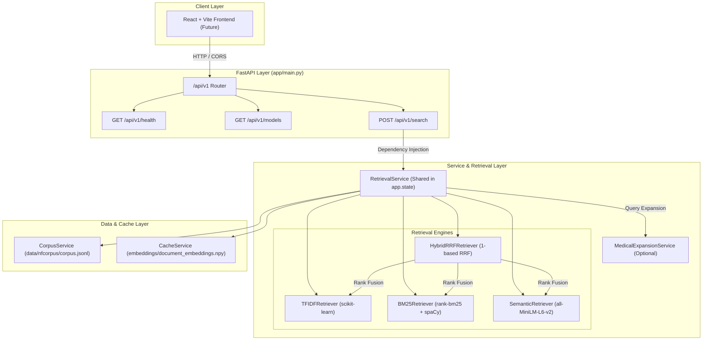

# Medical Search using NFCorpus — FastAPI Backend

A modular, production-ready **FastAPI application** and **Information Retrieval (IR) system** built on the **NFCorpus dataset** (a medical IR benchmark from BeIR). 

The system compares traditional keyword retrieval (**TF-IDF**), probabilistic lexical search (**BM25**), dense neural semantic search (**Sentence Transformers**), and hybrid ranking (**Reciprocal Rank Fusion — RRF**).

---

## System Architecture

All retrieval models, vectorizers, spaCy pipelines, and document embeddings are initialized **once at application startup** via FastAPI's `lifespan` context manager and held in memory. Search requests reuse these pre-warmed models for low-latency responses.



---

## 📁 Repository Structure

```text
medical-search-nfcorpus/
├── app/
│   ├── __init__.py
│   ├── main.py                    # FastAPI application & lifespan management
│   ├── api/
│   │   ├── __init__.py
│   │   ├── dependencies.py        # Dependency injection (get_retrieval_service)
│   │   └── routes/
│   │       ├── health.py          # GET /api/v1/health
│   │       ├── search.py          # POST /api/v1/search
│   │       └── models.py          # GET /api/v1/models
│   ├── core/
│   │   ├── config.py              # Pydantic BaseSettings & environment variables
│   │   ├── logging.py             # Structured logging configuration
│   │   └── exceptions.py         # Custom application exceptions
│   ├── schemas/
│   │   ├── search.py              # Pydantic request/response models for search
│   │   ├── health.py              # Pydantic response models for health
│   │   └── models.py              # Pydantic response models for model info
│   ├── services/
│   │   ├── retrieval_service.py   # Main orchestrator holding all 4 model instances
│   │   ├── corpus_service.py      # Corpus loading & SHA256 fingerprinting
│   │   ├── cache_service.py       # Atomic persistent embedding cache validation
│   │   ├── expansion_service.py   # Medical term & synonym expansion service
│   │   └── evaluation_service.py  # Offline evaluation benchmark engine
│   ├── retrieval/
│   │   ├── base.py                # Abstract BaseRetriever protocol
│   │   ├── tfidf.py               # Sparse TF-IDF retriever
│   │   ├── bm25.py                # BM25Okapi retriever with medical negation preservation
│   │   ├── semantic.py            # Cosine similarity dense retriever
│   │   └── rrf.py                 # Reciprocal Rank Fusion hybrid engine
│   └── evaluation/
│       └── metrics.py             # Precision@k, Recall@k, MAP, nDCG@k calculation logic
├── data/
│   └── nfcorpus/
│       ├── corpus.jsonl
│       ├── queries.jsonl
│       └── qrels/                 # train.tsv, dev.tsv, test.tsv
├── embeddings/
│   ├── document_embeddings.npy    # Persistent NumPy document embeddings
│   └── metadata.json              # Enhanced cache metadata & fingerprint
├── results/                       # Generated evaluation benchmark reports
├── scripts/
│   ├── download_dataset.py        # Dataset downloader from Hugging Face
│   ├── inspect_dataset.py         # Dataset inspection tool
│   └── evaluate.py                # Offline evaluation benchmark CLI
├── src/                           # Refactored CLI search wrappers
├── tests/                         # Unit and integration test suite
├── .env.example                   # Environment variable template
├── .gitignore
├── pyproject.toml
└── README.md
```

---

## Quick Start & Installation

### 1. Prerequisites
- Python 3.9+
- Windows PowerShell / Bash

### 2. Environment Setup (Windows PowerShell)
```powershell
# Navigate to repository root
cd path/to/medical-search-nfcorpus

# Activate your existing virtual environment (or create one)
.\venv\Scripts\Activate.ps1
```

### 3. Install Dependencies & spaCy Model
```powershell
pip install -r pyproject.toml
# Or install editable package with dev dependencies:
pip install -e .[dev]

# Download spaCy English model (required for BM25 lemmatization)
python -m spacy download en_core_web_sm
```

---

## Running the FastAPI Backend

### Start Server (Single Worker Process)
```powershell
python app/main.py
```
Or using Uvicorn directly:
```powershell
uvicorn app.main:app --host 127.0.0.1 --port 8000 --reload
```

Interactive API documentation will be available at:
- **Swagger UI**: [http://127.0.0.1:8000/docs](http://127.0.0.1:8000/docs)
- **ReDoc**: [http://127.0.0.1:8000/redoc](http://127.0.0.1:8000/redoc)

---

## API Endpoints & Request/Response Formats

### 1. Health Endpoint
`GET /api/v1/health`

**Response (`200 OK`)**:
```json
{
  "status": "healthy",
  "initialized": true,
  "retrievers": {
    "tfidf": true,
    "bm25": true,
    "semantic": true,
    "rrf": true
  },
  "cache_status": "loaded_from_cache",
  "document_count": 3633
}
```

### 2. Models Endpoint
`GET /api/v1/models`

**Response (`200 OK`)**:
```json
{
  "models": [
    {
      "id": "rrf",
      "name": "Reciprocal Rank Fusion (Hybrid)",
      "description": "Fuses TF-IDF, BM25, and Semantic rankings using 1-based RRF positional scoring.",
      "type": "hybrid"
    },
    {
      "id": "semantic",
      "name": "Semantic Search (sentence-transformers/all-MiniLM-L6-v2)",
      "description": "Dense retrieval using pre-normalized sentence transformer embeddings and cosine similarity.",
      "type": "neural"
    },
    {
      "id": "bm25",
      "name": "BM25 Okapi",
      "description": "Probabilistic lexical search using spaCy lemmatization and medical negation preservation.",
      "type": "lexical"
    },
    {
      "id": "tfidf",
      "name": "TF-IDF",
      "description": "Vector space model using TF-IDF with unigram/bigram n-grams.",
      "type": "lexical"
    }
  ]
}
```

### 3. Search Endpoint
`POST /api/v1/search`

**Request Body**:
```json
{
  "query": "What are the health benefits of omega-3?",
  "model": "rrf",
  "top_k": 5,
  "enable_expansion": false
}
```

**Response (`200 OK`)**:
```json
{
  "query": "What are the health benefits of omega-3?",
  "expanded_query": null,
  "model": "rrf",
  "count": 5,
  "results": [
    {
      "id": "MED-10",
      "title": "Statin Use and Breast Cancer Survival...",
      "text": "Recent studies have suggested that statins...",
      "score": 0.048387,
      "retriever": "rrf",
      "matched_terms": null,
      "component_ranks": {
        "tfidf": 2,
        "bm25": 1,
        "semantic": 4
      },
      "component_scores": {
        "tfidf": 0.4215,
        "bm25": 14.821,
        "semantic": 0.6842
      }
    }
  ]
}
```

---

## 💾 Embedding Cache & Validation Strategy

The semantic retrieval model uses `sentence-transformers/all-MiniLM-L6-v2` to map medical documents into 384-dimensional embeddings.

- **Storage Location**: `embeddings/document_embeddings.npy` and `embeddings/metadata.json`.
- **Validation Criteria**:
  1. NumPy array shape must match `(3633, 384)`.
  2. `allow_pickle=False` is strictly enforced for safety.
  3. Metadata matches `model_name`, `embedding_dim`, `num_documents`, and SHA256 `corpus_fingerprint`.
- **Atomic Cache Writing**: Embeddings are written to `*_tmp.npy` and `*_tmp.json` before being atomically moved into place.
- **Cache Invalidation**: Modifying `corpus.jsonl` or changing the embedding model invalidates the cache automatically and triggers clean re-encoding at startup.

To force regenerating the cache, delete the contents of `embeddings/` and restart the application.

---

## Offline Evaluation & Metrics

The offline benchmark compares all 4 retrieval engines against the ground-truth relevance judgments in `data/nfcorpus/qrels/test.tsv`.

### Metric Definitions
- **Precision@10**: Proportion of top-10 retrieved documents that are relevant ($\text{rel} \ge 1$).
- **Recall@10**: Proportion of total relevant documents for the query that appear in the top 10.
- **MAP (Mean Average Precision)**: Mean of Average Precision scores over all queries, accounting for precision at every hit position in the candidate ranking.
- **nDCG@10 (Normalized Discounted Cumulative Gain at 10)**: Evaluates ranking quality using graded relevance ($0$ = non-relevant, $1$ = marginally relevant, $2$ = highly relevant) divided by Ideal DCG:
  $$DCG@k = \sum_{i=1}^k \frac{2^{rel_i} - 1}{\log_2(i + 1)}$$

### Run Benchmark CLI
```powershell
python scripts/evaluate.py --split test --metric-k 10
```
Machine-readable JSON reports will be saved to `results/evaluation_test.json`.

---

## Testing

Run the automated pytest suite (18 unit & integration tests):
```powershell
pytest tests/
```

---

## Future React Frontend Integration Plan

The backend is configured with CORS enabled for `http://localhost:3000` and `http://localhost:5173`. When building the React + Vite frontend:
1. Make POST requests to `/api/v1/search` with `{ query, model, top_k }`.
2. Display engine comparison side-by-side using the `component_ranks` and `component_scores` returned in the JSON payload.
3. Query readiness status from `/api/v1/health` during app load.
